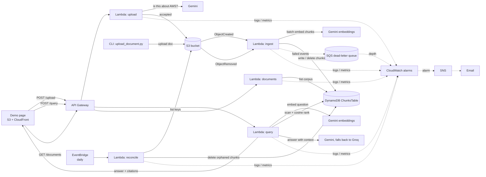
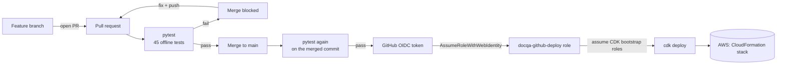

# AWS Document Q&A

[](https://github.com/Shikha14DoD/AWS-DOC-QA/actions/workflows/tests.yml)

**[Live demo](https://dsocz579or6gq.cloudfront.net)**
\- ask it a question, get a real answer from the deployed API with citations.
Shows a live "knowledge base" panel of exactly which documents are
answerable, and you can upload your own (AWS-related content only - it's
checked). S3 + CloudFront (no third-party host, no backend of its own beyond
the API below) - the bucket is private, CloudFront reads it via Origin Access
Control, and CloudFront's own domain serves HTTPS at no extra cost.

A small serverless RAG API on AWS. You upload documents, then ask questions about
them and get back an answer with citations to the chunks it used. The corpus
(`corpus/*.md`) is a small set of real AWS documentation excerpts - Lambda
quotas, DynamoDB basics, S3 storage classes - paraphrased from AWS's own docs
with the source URL on each file, not invented facts.

I built this mostly to have a real AWS project to point at - Lambda, DynamoDB,
S3, API Gateway, all defined with CDK. The part I care about is the reliability
stuff (retries, LLM fallback, a dead-letter queue for failed ingests), not the
RAG pattern itself.

**Status:** deployed and working. Live API, real ingestion, real answers with
citations, and a small eval harness run against it (see below).

## Architecture



There's no vector database. The table stores the vectors as JSON and the Lambda
does the cosine similarity in memory. Fine at this size; I'd move to OpenSearch
or pgvector if the corpus got large.

## Why these choices

- **DynamoDB instead of a vector DB** - on-demand DynamoDB costs nothing when
  idle. OpenSearch Serverless bills by the hour no matter what.
- **Gemini / Groq instead of Bedrock** - Bedrock charges per token from the
  first call. Gemini and Groq both have real free tiers.
- **Lambda instead of EC2** - the work is bursty, a few seconds when a doc
  lands and then nothing. An instance would just sit there costing money.
- **API key in SSM Parameter Store** - free, and the key never ends up in the
  repo or the CloudFormation template. Secrets Manager would cost per secret.
- **A Lambda layer for the shared Gemini/Groq client** - both functions need
  the same embed/generate/retry code, so it lives in one place instead of two
  copies drifting apart.
- **pypdf, vendored, for PDF text extraction** - the one third-party
  dependency anywhere in this project (everything else is deliberately
  stdlib-only). No reasonable way around it - hand-rolling a PDF parser isn't
  proportionate. It's pure Python, so no compiled-extension/Docker build step
  is needed to make it run on Lambda's Linux runtime.

- **S3 + CloudFront for the demo page, not a third-party host** - the whole
  project's argument is "AWS-native," so the demo shouldn't live somewhere
  else. Originally a plain S3 website endpoint (HTTP only - fine for a public
  read-only page, but a browser still flags it "Not secure"), now a private
  bucket behind CloudFront: Origin Access Control instead of a public bucket
  policy, and HTTPS on CloudFront's own domain at no extra cost, since its
  data-transfer/request free tier doesn't expire after 12 months the way most
  AWS free tiers do.
- **An LLM call to gate uploads, not a keyword filter** - "is this document
  about AWS" is a judgment call a regex can't make reliably; a cheap
  classification prompt (same Gemini/Groq client as everything else) can.

The whole thing is meant to stay inside the AWS free tier. The one exception:
API Gateway's free tier is 1M requests/month for 12 months, then ~$1/million -
at this project's traffic that's fractions of a cent, but it's worth being
honest that it's not permanently free the way Lambda/DynamoDB/S3 are.

## Upload + demo

The only public *write* surface in the project is `POST /upload` - everything
else is read-only or S3-event-triggered. It validates hard before touching
anything: allowed extension (`.txt`/`.md`/`.markdown`/`.rst`/`.pdf`), a size
cap (20 KB text, 2 MB PDF), and an LLM check that the content is actually
AWS-related (rejects with HTTP 422 and why if not). Accepted uploads land in
the same S3 bucket the CLI script uses, so ingestion is identical either way.
The route is throttled separately from `/query` (1 req/s, burst 2 vs 10 req/s,
burst 20) since uploads should be rare and each one costs an LLM call.

PDFs need a real parsing library - `pypdf`, the one third-party dependency in
the shared Lambda layer (vendored, not pip-installed at deploy time, since
it's pure Python with no build step needed). Text is extracted once by the
upload Lambda just to run the topic check, and again by the ingest Lambda
after the original PDF bytes land in S3 - same extraction path either way,
whether a document arrives via the API or the CLI script. No OCR: a
scanned/image-only PDF has no text layer to extract and gets rejected with a
clear reason rather than silently indexing nothing.

Only the first 50 pages of a PDF are indexed (`PDF_MAX_PAGES`), to keep the
work and embedding calls per upload bounded. That cap used to be invisible - a
real 62-page PDF quietly lost its last 12 pages - so now the upload response
says "only the first 50 of N pages will be indexed" and the ingest log records
`pages_total` vs `pages_indexed`.

`GET /documents` lists what's currently in the corpus (document name + chunk
count, no LLM call) - the demo page's "Knowledge base" panel is just that
endpoint rendered, so visitors see what's actually answerable before they ask
anything, and it refreshes itself after an upload is accepted.

The demo page doesn't hardcode the API URL. The CDK deploy writes a
`config.js` next to it with the API's real endpoint (`s3deploy.Source.data`
with the endpoint as a deploy-time token), so the deploy that creates the API
is also the thing that tells the page where it is.

## Reliability

- Retry with backoff on every Gemini call, but only for transient failures
  (429/5xx/timeout) - a bad request fails fast instead of retrying a bug 3 times.
  When a 429 says how long to wait (`Retry-After`, or the `retryDelay` in
  Gemini's error body), the retry waits that long instead of guessing, capped
  at 20 s so it can't sleep past the Lambda timeout
- Ingest embeds a document's chunks in batches (`batchEmbedContents`, up to
  100 per call) instead of one HTTP call per chunk
- If Gemini's answer call keeps failing, the query Lambda falls back to Groq;
  the response says which provider actually answered
- SQS dead-letter queue on the ingest Lambda, so a document that fails to
  ingest is visible and replayable instead of silently vanishing
- Deleting a file from S3 deletes its chunks (`ObjectRemoved` event), so the
  API can't keep citing a document that's gone. A daily reconcile job compares
  bucket keys against the table and removes anything orphaned, for deletes
  that never produced an event (e.g. S3 Lifecycle expiry)
- Every request logs one JSON line (latency, success, provider) to CloudWatch;
  three alarms watch ingest errors, query errors, and DLQ depth, and email
  through SNS when they fire (the address is deploy-time config, not in the
  repo)

Deploying this for real (rather than just `cdk synth` passing) surfaced a
string of real bugs none of which show up in a mocked unit test: a reserved
SSM parameter prefix, two retired Gemini models, Groq's CDN blocking Lambda's
default User-Agent, a script that grabbed the wrong S3 bucket once there were
two, a CloudFormation resource whose nested properties want different
casing than its own top-level ones, a missing resource dependency that broke
deploy ordering, and a stack that got stuck in `UPDATE_ROLLBACK_FAILED` and
needed a scoped IAM permission (and, once, a temporary admin re-attach via
root) to recover. Every one of them only exists because something real -
AWS's own naming rules, a vendor's model lifecycle, a real second resource,
CloudFormation's own inconsistencies - was on the other end of the call.
Details in `INTERVIEW_NOTES.md` (local, not committed).

## Eval

`scripts/eval.py` runs a fixed set of questions against the live deployed API
(not a mock) and checks three things: did retrieval pull a chunk from the
right source document, does the answer contain the expected fact, and for
questions the corpus can't answer at all, does the model decline instead of
making something up.

```
retrieval hit rate:  100%  (8/8)
answer accuracy:     88%  (7/8)
hallucination rate:  0%  (0/3)
```

(Latest run is against the current 118-chunk corpus: the three docs plus a real
62-page VPC PDF. The numbers didn't move when the corpus grew 10x.)

Retrieval has been 100% across every run. Answer accuracy has moved around
run to run (as low as 62%) - not from wrong retrieval, but from two separate
harness issues, both fixed rather than papered over by re-running until the
score looked good:

1. Gemini's free tier rate-limits under back-to-back calls, so some questions
   answer through the Groq fallback with different phrasing than my exact
   keyword check expected.
2. Both LLMs favor typographically "correct" Unicode punctuation over plain
   ASCII - a narrow no-break space in "400 KB", a non-breaking hyphen in
   "on-demand" - which an exact-string match was wrongly failing. The eval
   script now normalizes both before comparing.

The one remaining miss is a genuine limitation of keyword matching, not a
bug: a correct answer paraphrased using different words than my expected
keyword. Full history in `INTERVIEW_NOTES.md`.

**Bigger eval, not yet recorded.** The question set is now 19 (14 in-corpus,
5 out-of-scope), and the script can grade each answer with an LLM judge
(`--judge`) against a reference answer, alongside the keyword check, and
repeat the whole set (`--runs N`) to report a range instead of one sample.
The numbers above are still from the earlier 11-question run - the new set
hasn't produced a valid run yet, and I'd rather leave the old numbers up than
post unreliable ones. The first attempt used Gemini as the judge, which
burned the free tier's 20 generate requests per day - the same quota the
live API answers from - so only 2 of 14 answers in the second run got
graded. That result was discarded, and the judge now runs on Groq. It also
surfaced a real limit: the live demo answers from Gemini for about 20
questions a day, then everything comes from the Groq fallback.

## IAM

The deploying IAM user (`shikha-dev`) had `AdministratorAccess` while the
project's service footprint was still being figured out. It's now scoped down
to `infrastructure/iam/shikha-dev-least-privilege.json` - mostly just
`sts:AssumeRole` on the IAM roles `cdk bootstrap` already created for
deployment, plus the handful of direct actions actually used day to day (SSM,
S3 upload and delete, DynamoDB scan/query/delete-item, CloudWatch Logs, Lambda
inspect, DLQ read). `AdministratorAccess` is detached and stays detached.
Before detaching it the last time, I simulated the attached policy against the
real operations (`iam:SimulateCustomPolicy`) - because admin masks every gap
in a scoped policy - which found a bug that had been there since the policy
was written (`lambda:ListFunctions` can't be resource-scoped, so scoping it made
it useless). Then I detached it and re-ran the real commands plus a full
`cdk deploy` without admin.

One addition since: a deploy that failed mid-update left the stack stuck in
`UPDATE_ROLLBACK_FAILED`, which needs `cloudformation:ContinueUpdateRollback`
to recover - a permission `cdk deploy` never needs directly (it assumes
`cfn-exec-role` for normal operations), so the scoped policy correctly didn't
have it. That's a legitimate, narrow exception, now added scoped to this one
stack. Recovering also required briefly re-attaching `AdministratorAccess`
via the AWS root account, since a fully-scoped `shikha-dev` can't grant
itself new permissions either - a real demonstration of least-privilege
working exactly as intended, if inconvenient mid-incident.

## CI/CD



`main` is branch-protected: no direct pushes, every change comes through a
pull request that has to pass the `pytest` check against an up-to-date
branch, and the rule applies to admins too. No approvals are required - it's
a one-person repo and GitHub doesn't let you approve your own PR - so the
test check is the gate.

GitHub Actions (`.github/workflows/tests.yml`) runs the 45 unit tests on every
push and pull request - no AWS credentials involved, since nothing in them
makes a real call. On a push to `main`, after the tests pass, a second job
runs `cdk deploy` using **GitHub OIDC**: GitHub hands the job a short-lived
token that AWS exchanges for temporary credentials, so there are no long-lived
AWS keys stored in the repo settings. The role it assumes can only assume the
CDK bootstrap roles (same footprint as the deploy user above), and its trust
policy only accepts this repo's `main` branch - a pull request can't deploy.
The deploy job stays skipped until the role exists (a repo variable gates it),
so the workflow is green either way; setup steps are in
`infrastructure/iam/README.md`. The first deploy through it succeeded on
2026-09-23; getting there needed the trust policy to match GitHub's newer
token format, which identifies the repo by ID rather than name (found by
printing the token's claims, since the failure message only said "not
authorized").

## Running it

You need AWS credentials, Python 3.12, Node (for the CDK CLI), a Gemini API
key, and a Groq API key.

```bash
cd infrastructure
python -m venv .venv && source .venv/Scripts/activate
pip install -r requirements.txt

# vendor pypdf into the shared Lambda layer (not committed to git, same as
# any other dependency install - see lambdas/layers/common/requirements.txt)
cd .. && pip install -r lambdas/layers/common/requirements.txt \
  -t lambdas/layers/common/python && cd infrastructure

# store the API keys once
aws ssm put-parameter --name /docqa/gemini-api-key --type SecureString \
  --value "YOUR_GEMINI_KEY" --region us-east-2
aws ssm put-parameter --name /docqa/groq-api-key --type SecureString \
  --value "YOUR_GROQ_KEY" --region us-east-2

# alarmEmail is optional - leave it off and the alarms exist with no email
cdk deploy InfrastructureStack --require-approval never -c alarmEmail=you@example.com

cd ..
python scripts/upload_document.py corpus/lambda-limits.md
python scripts/ask.py "What is the maximum Lambda timeout?"
python scripts/eval.py                     # keyword-graded, one run
python scripts/eval.py --judge --runs 2    # LLM-judged, repeated

# or hit the upload API directly, like the demo page does
curl -X POST "$(aws cloudformation describe-stacks --stack-name InfrastructureStack \
  --region us-east-2 --query "Stacks[0].Outputs[?OutputKey=='QueryApiUrl'].OutputValue" \
  --output text)/upload" \
  -H "Content-Type: application/json" \
  -d '{"filename":"note.md","content":"EC2 instances are billed per second..."}'
```

## Plan

- [x] Day 1 - ingestion: DynamoDB table, ingest Lambda, S3 trigger
- [x] Day 2 - query Lambda + API Gateway, end to end
- [x] Day 3 - Gemini/Groq fallback, retries, SQS dead-letter queue, CloudWatch alarms
- [x] Day 4 - deployed for real, retrieval eval, IAM scoped to least-privilege
- [x] Bonus - real AWS-doc corpus, self-hosted demo page with upload + a
      live knowledge-base panel, per-route throttling
- [x] CI - unit tests on every push and PR (GitHub Actions)
- [x] CD - deploy on merge via GitHub OIDC (first successful run 2026-09-23)
- [x] Hardening - S3-delete cleanup + daily reconcile job, SNS alarm emails,
      branch protection on `main`, deploy-time API URL for the demo, batched
      embeddings + server retry hints, 19-question LLM-judged eval
- [ ] Record a valid run of the 19-question eval
